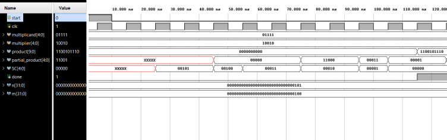

# Booth Multiplier — Verilog Implementation

A fully synthesizable, RTL-level implementation of the **Booth's Multiplication Algorithm** in Verilog, designed and simulated using Xilinx Vivado.

---

## 📐 Algorithm Overview

Booth's algorithm is a signed binary multiplication algorithm that handles both positive and negative (two's complement) operands efficiently by reducing the number of partial products through recoding. It inspects two bits at a time (`q0` and `qn1`) to decide whether to add, subtract, or do nothing with the multiplicand.

| `q0` | `qn1` | Operation |
|------|-------|-----------|
| 0    | 0     | Shift (no-op) |
| 1    | 0     | Subtract BR from AC |
| 0    | 1     | Add BR to AC |
| 1    | 1     | Shift (no-op) |

---

## 🗂️ Project Structure

```
Booth_Multiplier_Project/
├── src/                        # RTL source files
│   ├── Booth_Multiplier.v      # Top-level module
│   ├── Booth_Datapath.v        # Datapath unit
│   ├── Booth_Control_Unit.v    # FSM-based control unit
│   ├── n_bit_adder_subtractor.v# N-bit adder/subtractor
│   ├── sequence_counter.v      # Down-counter for iteration tracking
│   └── full_adder.v            # 1-bit full adder (primitive)
├── sim/
│   ├── testbench/
│   │   └── Booth_Multiplier_tb.v  # Simulation testbench
│   └── waveforms/              # Simulation waveform screenshots
├── docs/                       # Reports and documentation
└── README.md
```

---

## 🔩 Module Hierarchy

```
Booth_Multiplier  (top)
├── Booth_Datapath
│   ├── n_bit_adder_subtractor
│   │   └── full_adder  (×n instances)
│   └── sequence_counter
└── Booth_Control_Unit
```

---

## 📦 Module Descriptions

### `Booth_Multiplier` (Top)
**File:** `src/Booth_Multiplier.v`

Parameterized top-level wrapper. Instantiates the datapath and control unit and connects them via internal control/status signals.

| Port | Direction | Width | Description |
|------|-----------|-------|-------------|
| `clk` | Input | 1 | Clock signal |
| `start` | Input | 1 | Initiates multiplication |
| `multiplicand` | Input | n | Signed multiplicand (BR) |
| `multiplier` | Input | n | Signed multiplier (QR) |
| `product` | Output | 2n | Final signed product |
| `partial_product` | Output | n | Last partial product (AC) |
| `SC` | Output | n | Step counter value |
| `done` | Output | 1 | High when result is ready |

---

### `Booth_Control_Unit`
**File:** `src/Booth_Control_Unit.v`

A Moore-type FSM with 7 states implementing the Booth control flow:

| State | Action |
|-------|--------|
| S0 | IDLE — wait for `start` |
| S1 | Load BR (multiplicand) and QR (multiplier) |
| S2 | Clear AC, clear qn1 ff, load counter |
| S3 | Add: `AC ← AC + BR` |
| S4 | Subtract: `AC ← AC − BR` |
| S5 | Arithmetic shift right (`{AC, QR, qn1} >> 1`), decrement counter |
| S6 | DONE — assert `done` |

---

### `Booth_Datapath`
**File:** `src/Booth_Datapath.v`

Contains all registers (`AC`, `QR`, `BR`) and their load/clear logic, the ASHR (arithmetic shift right) operation on `{AC, QR, qn1}`, and product assembly.

---

### `n_bit_adder_subtractor`
**File:** `src/n_bit_adder_subtractor.v`

Parameterized n-bit adder/subtractor. When `addsub_inst = 1`, performs subtraction via XOR + carry-in trick. Internally chains `n` instances of `full_adder`.

---

### `sequence_counter`
**File:** `src/sequence_counter.v`

A parameterized down-counter loaded with `n` on `ldCNT`. Decrements on each `decr` pulse. When it reaches 0, `cntz` goes high, signalling the control unit to terminate.

---

### `full_adder`
**File:** `src/full_adder.v`

Gate-level 1-bit full adder using `xor`, `and`, and `or` primitives.

---

## 🧪 Testbench

**File:** `sim/testbench/Booth_Multiplier_tb.v`

Tests the multiplier with the sample case:
- **Multiplicand** = 15 (positive)
- **Multiplier** = −14 (negative)
- **Expected product** = −210

The testbench prints a cycle-by-cycle trace of `AC`, `QR`, `BR`, `SC`, `qn1`, all control signals, and the final product at every positive clock edge.

---

## 🖥️ Simulation & Synthesis

**Tool:** Xilinx Vivado 2024.2

### Run Behavioral Simulation
1. Open Vivado and create/import the project.
2. Add all files from `src/` as **Design Sources**.
3. Add `sim/testbench/Booth_Multiplier_tb.v` as a **Simulation Source**.
4. Set `Booth_Multiplier_tb` as the top simulation module.
5. Click **Run Simulation → Run Behavioral Simulation**.

### Changing the Bit-Width
The design is fully parameterized. Change the parameter `n` in the testbench to test with different word sizes:
```verilog
parameter n = 8; // 8-bit signed multiplication → 16-bit product
```

---

## 📊 Simulation Waveforms

Waveform screenshots from Vivado's behavioral simulation are shown below.

### Test Case: 15 × (−14) = −210

| Signal | Value |
|--------|-------|
| `multiplicand` | `01111` (+15) |
| `multiplier` | `10010` (−14) |
| `product` | `1100101110` (−210) |



The waveform shows:
- **`start`** goes high to kick off the algorithm.
- **`SC`** (step counter) counts down from `n` → 0 across shift cycles.
- **`partial_product`** updates after each arithmetic shift right step.
- **`done`** asserts high once the counter reaches zero and the final product is latched into `{AC, QR}`.
- **`product`** holds the correct 2n-bit signed result at completion.

---

## 👤 Author

> Digital System Design — Booth Multiplier Project  
> Implemented in Verilog | Simulated & Synthesized on Xilinx Vivado 2024.2

